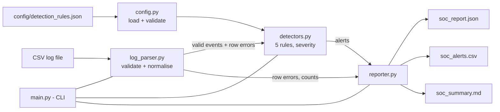

# Architecture

## Modules and responsibilities

| File | Responsibility | Knows about |
|---|---|---|
| `src/log_parser.py` | Read the CSV, validate every row, normalise timestamps to UTC, classify IP type. Bad rows are collected, not fatal. | Nothing about rules or reports |
| `src/config.py` | Defaults, JSON loading, strict validation (typos in config keys are errors). | Nothing about logs |
| `src/detectors.py` | Pure functions: `events + config -> alerts`. Severity logic and recommended actions. | No file or network access |
| `src/reporter.py` | Turns alerts into one report dictionary, then writes JSON, CSV, Markdown. | No detection logic |
| `src/main.py` | Argument parsing, exit codes, wiring the modules together. | Everything, but does no analysis itself |

Keeping detection separate from parsing and reporting means each part can be tested alone:
the detector tests build events in memory and never touch a file.

## Design decisions

* **Standard library only.** Nothing to install to run it, fewer things to go wrong, easy to audit.
* **Malformed rows do not stop analysis.** Real logs are messy. They are listed in every report.
  The whole file is rejected only if it is unusable (missing, empty, wrong columns, not UTF-8).
* **UTC everywhere.** Mixing timezones is a classic source of wrong conclusions.
* **Deterministic.** Same input + same config = same alerts in the same order. The analysis timestamp
  is the only value that changes, and tests inject a fixed one.
* **Read-only and offline.** The input is opened for reading only; there is no network code.
* **Safe reports.** Log text is untrusted: the CSV report neutralises spreadsheet formulas (`=`, `+`,
  `-`, `@`) and the Markdown report escapes `|`, `<` and `>`.
* **Cautious wording.** Every alert explanation says what was observed and what else could explain it.

## Exit codes

| Code | Meaning |
|---|---|
| 0 | Success |
| 2 | Invalid input: missing/empty file, wrong columns, bad config or arguments; `validate` also returns 2 if any row is malformed |
| 3 | Processing error, e.g. the output directory cannot be written |

## Arabic summary / ملخص بالعربية

يقرأ **المحلل** ملف السجلات (`log_parser`) ويتحقق من كل صف، ثم تقوم **القواعد** (`detectors`) بالبحث عن الأنماط
المشبوهة وتحديد الخطورة، وأخيرًا يكتب **المُبلِّغ** (`reporter`) ثلاثة تقارير (JSON وCSV وMarkdown).
ملف `main.py` هو الواجهة التي تربط كل هذه الأجزاء. فصل كل جزء عن الآخر يجعل الاختبار والتطوير أسهل.
